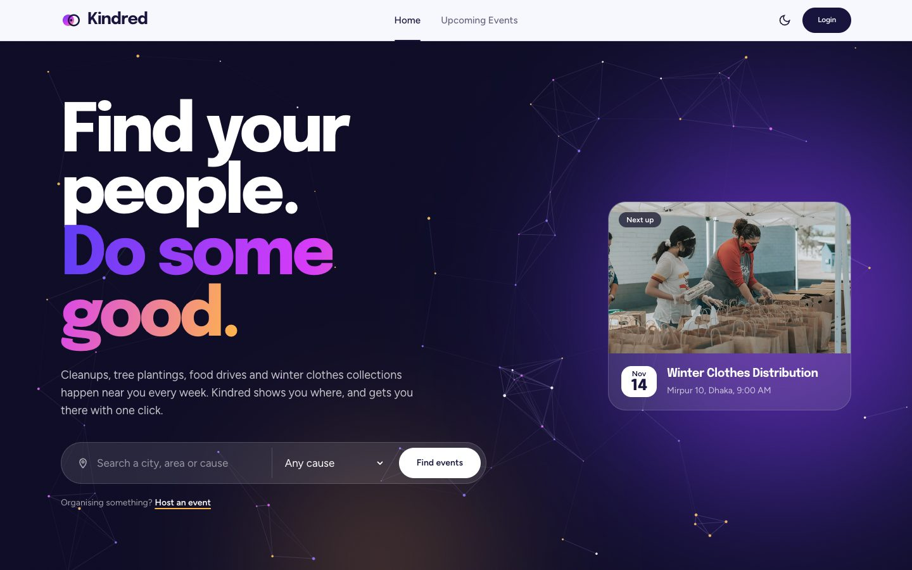
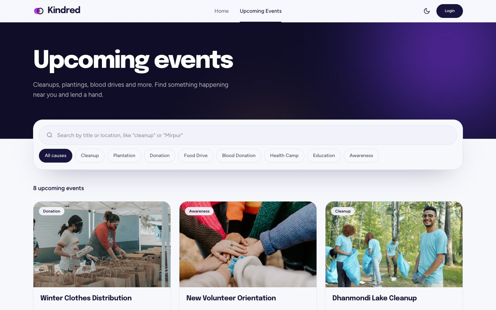
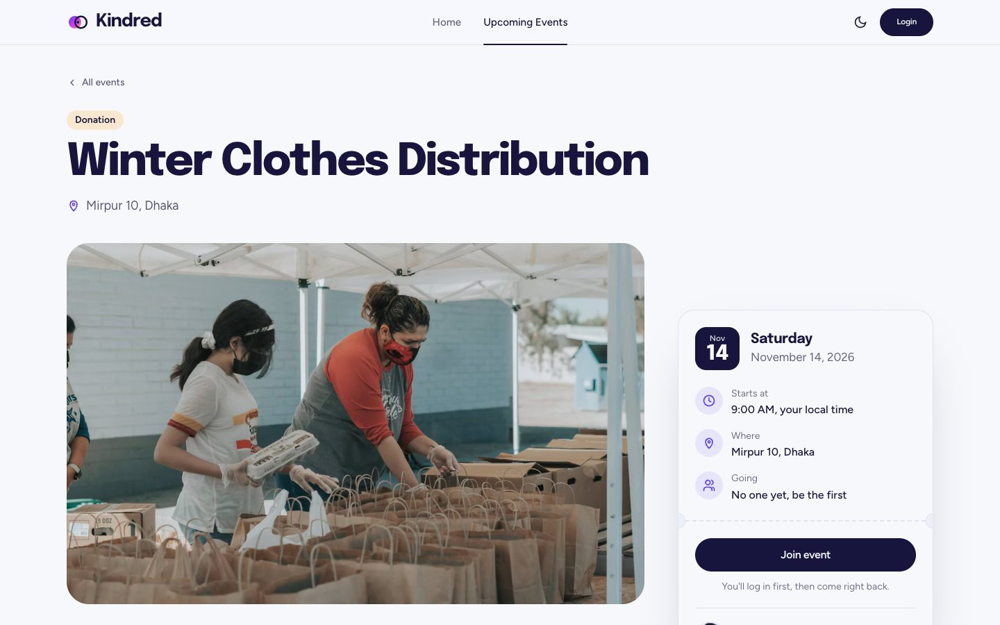
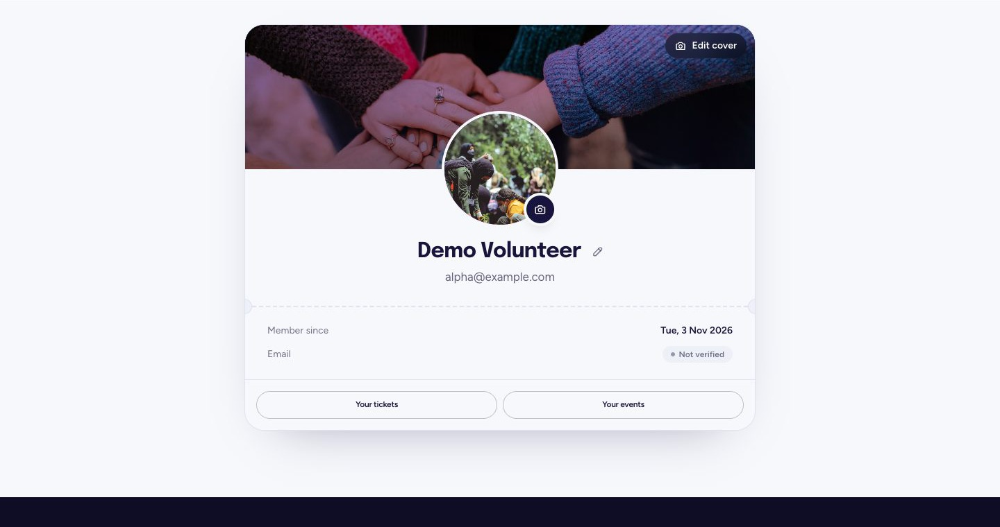
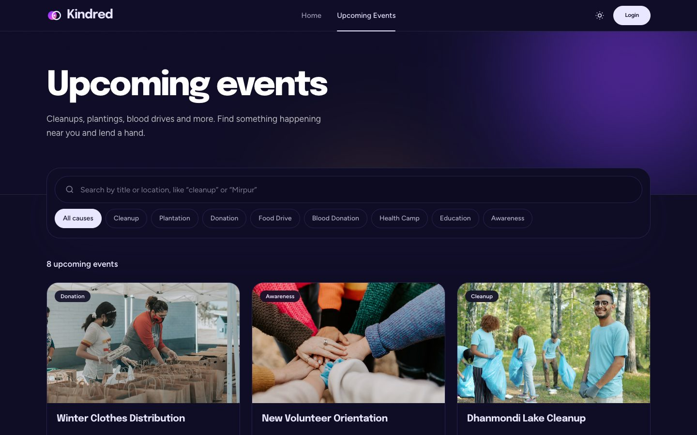
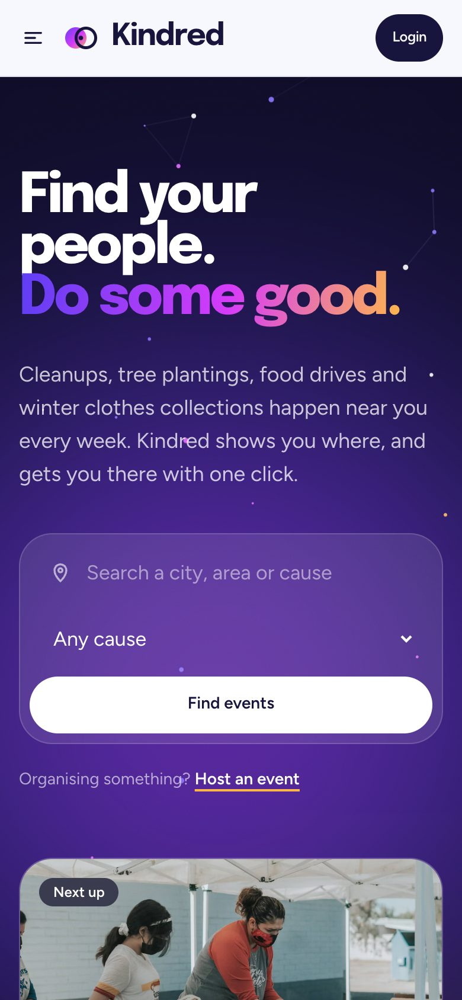

# Kindred - Community Events Platform

**Live site:** https://kindred-events.vercel.app

Kindred is a place where people can create, join and keep track of social service events in their own area. Things like winter clothes distribution, tree plantation, area cleanup or a blood donation camp.



## Features

- **Create events** - any logged in user can post an event with type, location, thumbnail and a future date (past dates are blocked on both client and server).
- **Upcoming events only** - the events page shows only events that did not happen yet, with search by title/location and a filter by event type.
- **Join with one click** - open any event and join it. Event details are public, but joining needs login, after login you come back to the same event.
- **Joined events** - a private page with every event you joined, sorted by event date.
- **Manage your own events** - update or delete only the events you created, delete asks for confirmation first.
- **Login options** - email and password (with password rules), Google or GitHub.
- **Profile** - see your profile and update your name and photo.
- **Dark and light theme** - one click toggle, it remembers your choice.
- **Protected API** - the Express server checks a JWT from Better Auth on every private route.
- **Loading skeletons** and toast messages everywhere, no default browser alerts.

## Extra features

- **Image upload** - on register, profile and the event form you can upload a photo (JPG, PNG or WebP, up to 2 MB) or paste an image URL.
- **Search and filter** - search events by title or location and filter by event type, right from the home page hero.
- **Leave an event** - changed your plans? Leave an event you joined with one click.
- **Live preview** - see how your event card will look while you fill in the form.
- **Next up** - the home page highlights the very next event so you never miss it.

## Screenshots

| Upcoming events | Event details |
| --- | --- |
|  |  |
| **Profile with cover photo** | **Dark mode** |
|  |  |

<p align="center">
  
</p>

## Tech used

- Next.js (App Router) + TypeScript
- Tailwind CSS + daisyUI
- Better Auth with the MongoDB adapter and JWT plugin
- Express + MongoDB on the server ([server repo](https://github.com/Md-Foisal/kindred-server))
- Sonner for toasts

## Run locally

```bash
npm install
cp .env.example .env.local   # fill in the values
npm run dev
```

The server needs to be running too, check the server repo readme for that.
